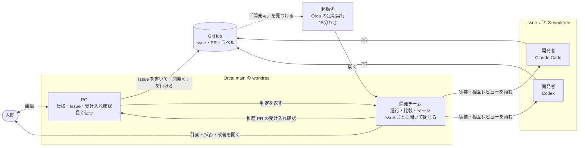
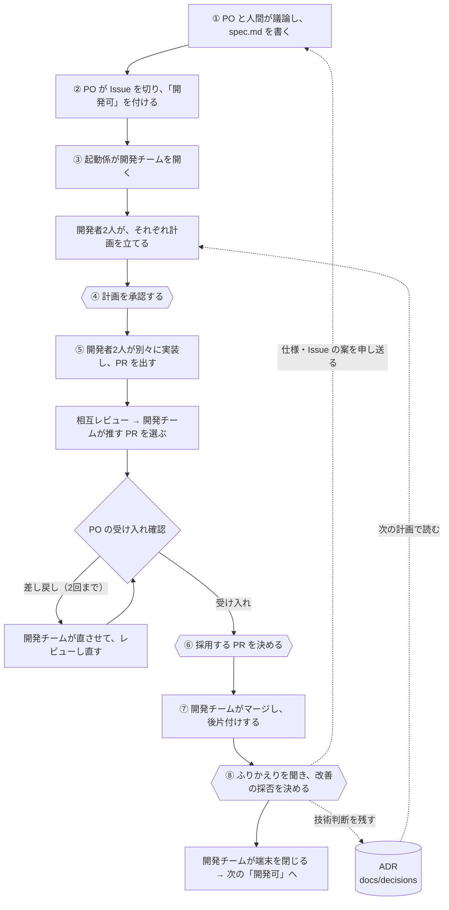

# わちゃメーター

オンライン会議に参加して「わちゃわちゃ」を観測し、終了時にスコアを参加者へ知らせるアプリを目指しています。現在は初期調査と Zoom SDK の初期化・認証の検証段階で、会議参加・採点機能は未実装です。

- [仕様と未決事項](docs/spec.md)
- [実現方法の初期調査](docs/research/feasibility.md)
- [現在地・次の Issue 候補](docs/next-issues.md)
- [最初の Zoom 試作：準備・SDK 入手手順](prototypes/zoom/README.md)
- [Mac での Zoom OAuth：設定と人間による認可の確認手順](prototypes/zoom/OAUTH.md)（本物の認可は未確認）

無料でできる構成を基本とし、Zoom の有料アカウントは候補に含めます。その他の有料ボット API・有料 AI API・有料サーバーを前提にせず、手元の PC での実行を優先して調査しています。

## 開発環境

Node.js 24 を使います。接続方式の選定前なので、共通の TypeScript 基盤のみを用意しています。

```sh
npm ci
npm run test
npm run typecheck
npm run lint
npm run build
```

テストは Zoom SDK の初期化・認証コマンド（判定・JWT 作成・プロセス管理）と、OAuth の loopback・PKCE・失敗/中断処理を対象にしています。SDK の実物での確認は [prototypes/zoom/README.md](prototypes/zoom/README.md)、本人による OAuth の確認は [prototypes/zoom/OAUTH.md](prototypes/zoom/OAUTH.md) の手順で手元で行います。開発サーバーや画面はまだありません。

以下は、このリポジトリで使うエージェント開発プロセスの説明です。

## 仕組み

### 席と受け渡し



| 席 | 担当 |
|---|---|
| PO | 人間と議論して `spec.md` と Issue を書き、着手してよい Issue に「開発可」を付ける。開発チームが推す PR を、受け入れ条件・仕様・使う人の目で確かめる（コードは見ない） |
| 開発チーム | 1つの Issue を最後まで進める。開発者2人に同じ Issue を別々に実装させ、互いにレビューさせて、どちらを採るかを推す。マージ・後片付け・ふりかえりのあと、自分の端末を閉じる |
| 開発者 | 自分の worktree で計画・実装・PR・レビューを行う（Claude Code と Codex が1人ずつ） |
| 起動係 | 「開発可」の Issue があり、動いている開発チームがいないときだけ、開発チームを開く（同時に1つまで） |

PO と開発チームを分けているのは、1つの端末にまとめると文脈がすぐあふれ、開発中にプロダクトの検討を進めにくくなるためです。

### Issue 1本の流れ

六角形が人間の判断です。それ以外はエージェントが進めます。



人間がすることは、PO との議論と、④⑥⑧の3つの判断です。記録は GitHub（Issue・PR・コメント）と `docs/issue-reports/` に残ります。ふりかえりでは、作業ごとの開始・終了の表（`work-times.py`）を見て、時間のかかった作業や過剰な作業を改善します。

## 始め方

1. GitHub で「Use this template」から新しいリポジトリを作り、手元に clone する
2. Orca でリポジトリを開き、main の worktree で端末を開く（Claude Code なら `claude --model opus --effort high`。Codex なら Orca からエージェントとして起動する）
3. 作りたいものを伝える。例: 「〇〇のようなスライドを、会社のデザインシステムで PowerPoint と PDF に出したい。セットアップして」

あとはエージェントが準備スキル [`setup-project`](.claude/skills/setup-project/SKILL.md) の手順で進めます（`/setup-project`・`$setup-project` で呼んでもかまいません）。
- **準備すること:** 作るものの決定（`CLAUDE.md`・`AGENTS.md`・`docs/testing.md` を埋める）、制作の環境、CI、ラベルと squash、この端末の PO 登録、起動係の定期実行
- **確かめること:** 最後に `bash .claude/skills/dual-implement/scripts/dev-team.sh doctor` を実行し、項目ごとの ○ / × を見せます。人間がやること（ログインや有料アプリの導入など）、起動係を有効にしてよいか、変えたファイルを確かめたら、コミットさせます
- **そのあと:** この端末がそのまま PO になり、`docs/spec.md` の初版づくりの議論に入ります

あとで「開発チームが起動しない」などと思ったら、`dev-team.sh doctor` で何が足りないかを確かめられます。

モデルの指定は `.claude/skills/dual-implement/SKILL.md` の「モデルの指定」と、[workflow.md](docs/workflow.md) のコーディネーターのモデルにあります。Codex の既定は `~/.codex/config.toml` で決まります。

## 中身

| 場所 | 中身 |
|---|---|
| [CLAUDE.md](CLAUDE.md) / [AGENTS.md](AGENTS.md) | エージェント向けガイド。「作るもの」と「開発設定」の表がプロジェクトごとの値 |
| `.claude/skills/` | 5つのスキル: `setup-project`（最初の準備）・`implement-issue`（1本実装）・`dual-implement`（開発チームの③〜⑥）・`accept-review`（PO の受け入れ確認）・`finish-issue`（⑦〜⑧）と補助スクリプト（準備の点検 `dev-team.sh doctor` を含む）。`.agents/skills/` は Codex 用のシンボリックリンク |
| [docs/workflow.md](docs/workflow.md) | 開発の進め方（3つの席・8ステップ） |
| [docs/testing.md](docs/testing.md) | テスト（確かめ方）とレビューの方針。作るものの種類ごとに書き換える |
| [docs/spec.md](docs/spec.md) / [docs/next-issues.md](docs/next-issues.md) | 仕様と現在地の雛形（PO が書く） |
| [docs/decisions/](docs/decisions/README.md) | 技術判断の記録（ADR）の書き方と雛形 |
| [docs/issue-reports/](docs/issue-reports/README.md) | Issue ごとの記録の書き方 |
| [profiles/](profiles/README.md) | 作るものの種類ごとの設定 |
| [docs/origin.md](docs/origin.md) | 取り出し元のプロジェクトとコミット |

## 前提
- [Orca](https://github.com/stablyai/orca)、Claude Code、Codex CLI、GitHub CLI（`gh`）、Python 3、Bash
- `.agents/skills/` はシンボリックリンクとして GitHub に保存されている。Windows で clone した場合の扱いは確かめていない
- まだ確かめていないこと: 開発チームを Codex にした構成

## ライセンス
[MIT No Attribution（MIT-0）](LICENSE)。著作権表示を残す必要もなく、自由に使い・変え・配れます。テンプレートから作ったプロジェクトでは、この `LICENSE` を消しても、自分のライセンスに差し替えても構いません。
