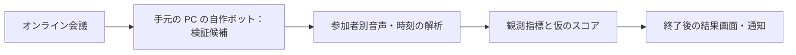

# わちゃメーター：実現方法の初期調査

調査日: 2026-11-07。公式資料による机上調査。初期調査時点では実会議接続・SDK 実行・採点精度は未検証。推奨や指標は提案であり、採用済みの仕様ではない。

## 試作の進捗（2026-11-09 追記）

Issue #1 は完了し、PR #2 を main へ取り込み済み。開発用 General App の認証情報を使い、Linux-all の SDK 7.2.1.5860（arm64）で初期化・認証成功・後始末を確認した。会議には参加しておらず、外部会議の用途・参加条件や音声取得の可否は未解決。詳細は [Issue #1 レポート](../issue-reports/issue-1.md)。

試作の C++ / TypeScript の分担と SDK の版は [ADR 0001](../decisions/0001-zoom-sdk試作はDocker上のC++とTypeScriptに分ける.md)・[ADR 0002](../decisions/0002-zoom-sdkは7.2.1.5860のarm64を使う.md) で採用済み。以下の外部資料の調査日は 2026-11-07 のままであり、この追記では再調査していない。

## ユーザー共有のライセンス

2026-11-07 確認: [Zoom APIライセンスおよび利用規定](https://www.zoom.com/ja/trust/legal/zoom-api-license-and-tou/)（ページ記載の最終更新: 2025-07-16）。開発チームへの確認対象は第1.2条（関連文書との関係）、第2.7条・第3.5条（データ取得と同意）、第2.8条（AIモデルの学習・評価等）、第6.1条（第三者利用）、第8条（料金）、第9条（機密保持）。SDK 本体・秘密情報は公開リポジトリへ含めない。

PO の判断: この規約への同意だけでボット用途・外部会議参加が承認されるとは判断しない。[Meeting SDK 概要](https://developers.zoom.us/docs/meeting-sdk/) のボット非対応という記載も再確認済み。用途条件は引き続き未解決。リンクの共有を、ユーザーが規約に同意済みであるという報告とは扱わない。

## お試し段階の進め方：問い合わせを開始条件にはしない

2026-11-07 更新。ユーザーは Notta のような参加者型ボットを参考に、まず小さく試したい。個別の Zoom 問い合わせを検討・開発開始の必須条件にした説明は訂正する。問い合わせなしでも、アプリの登録手順・テスト経路の確認やローカル実装準備は進められる。実会議接続の条件まで満たしたとは扱わない。

- Notta の公式ヘルプは、Notta Bot が外部参加者として入り、待機室での入室許可とホストの録音許可を受ける流れを説明している。参加者型サービスの実例である。ただし、同資料から Notta の内部実装・契約・新規アプリへの適用条件は分からない。[Notta 公式ヘルプ](https://support.notta.ai/hc/en-us/articles/36547390025243-What-should-I-do-if-Notta-Bot-fails-to-join-my-Zoom-meeting)
- Zoom には開発中アプリのベータテスト手続きがある。Meeting SDK のベータアプリを外部会議へ参加させる場合、認可 URL の Request to Share が承認され、その URL を外部の主催者へ共有する必要がある。個別のサポート問い合わせと、この管理画面からのテスト申請を混同しない。[ベータアプリの公式テスト手順](https://godevelopers.zoom.us/docs/distribute/sharing-private-and-beta-apps/#meeting-sdk-beta-apps-joining-external-meetings)
- ベータ申請には技術設計・セキュリティ資料等の要件があり、試作だから無条件に外部会議へ入れるわけではない。同手続きの存在は、下記のボット用途に関する不整合の解消や個別アプリの承認を保証しない。

次は個別問い合わせを先行させず、無料アカウントでの Meeting SDK アプリ作成・SDK 入手・Local Test / Beta Test の利用条件を具体化する。外部会議テストはその正式な条件を満たしてから行う。条件が解消しない箇所だけ、必要に応じて問い合わせを検討する。同じ契約内の入室確認だけで、他者主催会議への参加要件を満たしたとは扱わない。

## 現在の結論：他者主催の会議を対象に、SDK の採用可否を再確認する

2026-11-07 追記。ユーザーは他の人が主催する会議への参加を必要としており、同じ Zoom 契約内かは不明。外部アカウント主催の会議を含めて調査する。以前の「自分の開発者アカウント内で先に試す」という案は、利用要件を満たす検証としては採用しない。

**Meeting SDK の自作ボットを第一候補としていた判断は保留へ変更する。** 現在の公式資料には次の不整合がある。

- [Bot (OBF) の認証手順](https://developers.zoom.us/docs/meeting-sdk/auth/obf/) は、ボットが OAuth で許可したユーザーに紐付いて外部会議へ入る手順を説明している。同ページは外部会議へアクセスするアプリにレビューを求め、紐付いたユーザーの入室後にボットが参加し、そのユーザーが退出したらボットも退出するとしている。
- 一方、[Meeting SDK の概要](https://developers.zoom.us/docs/meeting-sdk/) の usage policy は、ボットや AI notetaker をサポートしないと記載し、リアルタイムメディア取得には RTMS を案内している。[Linux](https://developers.zoom.us/docs/meeting-sdk/linux/) と [macOS](https://developers.zoom.us/docs/meeting-sdk/macos/) の概要にも同じ記載がある。macOS に切り替えるだけで解消するとは扱わない。

古いサンプルや認証 API があることだけで、新規の観測ボットが審査・用途条件を満たすとは判断できない。用途・審査方針の適用範囲は未確認。公式テスト手続きの確認を進め、個別問い合わせをすべての準備作業の開始条件にはしない。技術的な入室可否と、外部会議向けに提供できるかを分ける。有料の Zoom 会議プランへ変更すればこの不整合が解消するとは言えない。

外部会議では、アプリのレビュー・OAuth のユーザー許可・ボット参加の認証と、主催者による待機室の入室許可・録音権限を別々に確認する。主催者の口頭許可だけで未審査アプリの外部会議参加が可能になるとは扱わない。

次の判断点は、この「会議へ独立した参加者として入り、発話の活発さを解析する新規アプリ」が Meeting SDK の審査対象として認められるか。現在の費用条件で成立する公式の方法はまだ確定していない。Zoom への問い合わせ送信・アプリ申請・契約は行っていない。問い合わせが必要なら、用途・参加形態・取得データを明示した具体的な文面を用意してから送信の可否を確認する。

以下の自作ボット案・段階的な接続検証は、上記を解消した後の候補として読む。

## 最新の費用条件

ユーザーは無料でできる構成を希望。ただし、Zoom の有料アカウントで実現できる構成は候補に含めてよいと補足した。Zoom の契約費と、わちゃメーターの追加サービス費を分けて比較する。

- 実現候補（SDK の用途・審査条件を確認するまで採用保留）: 手元の PC で Meeting SDK のボット・音声解析・結果表示を動かす構成。有料ボット API・有料 AI API・有料クラウドサーバーを使わない。
- 採点部分の先行検証候補: Zoom のローカル録音を手元で解析する。これは自動参加ボットの完成を意味しない。
- Recall.ai と Zoom RTMS: 以前の比較調査として下に残すが、現在の追加費用条件では候補から外す。無料体験だけを根拠に採用しない。
- Zoom の有料会議プランを持っているだけで、RTMS が無料になるとは扱わない。RTMS の導入資料には別途 Developer Pack の契約・クレジットが必要とある。[RTMS の前提条件](https://developers.zoom.us/docs/rtms/meetings/getting-started/)
- 既存 PC・通信環境を使う案であり、電気・通信・開発作業を含めた総費用がゼロという意味ではない。必要な SDK・モデル・仮想環境のライセンスと利用条件は採用時に確認する。

### 無料・Zoom 有料プランの比較

| 構成 | 確認できたこと | 未確認・制約 |
|---|---|---|
| Zoom Basic + ローカル録音 + ローカル解析 | Basic でもローカル録音と参加者別音声ファイル保存が可能 | Basic 主催会議は最大40分。録音の変換完了後に解析。自動参加は別途必要 |
| Zoom 有料会議プラン + ローカル録音 + ローカル解析 | 有料会議ライセンスで Basic の40分制限が外れる。ローカル録音も使える | プランの上限・保有契約を確認。採点アプリは未実装 |
| Zoom Basic／有料 + 自作 Meeting SDK ボット | 公式 SDK 比較には Basic も対象に含まれ、外部会議の認証条件は別に存在する | 実際のアカウントで生音声取得権限、SDK 入手条件、動作環境を検証する。Pro にすれば任意の会議へ無条件に参加できるわけではない |

根拠: [ローカル録音の要件・参加者別音声](https://support.zoom.com/hc/en/article?id=zm_kb&sysparm_article=KB0076922)、[アカウントと会議時間の FAQ](https://support.zoom.com/hc/en/article?id=zm_kb&sysparm_article=KB0061206)、[SDK 比較](https://support.zoom.com/hc/en/article?id=zm_kb&sysparm_article=KB0064689)、[SDK 認証](https://developers.zoom.us/docs/meeting-sdk/auth/)。

参加者別録音から重なりを測る場合は、各ファイルの開始位置・途中参加・録音の一時停止を含めて時刻を合わせられるか検証する。ファイルが分かれているだけで同期が保証されるとは仮定しない。

## 実現の見通し

会議に参加する処理と、ユーザーが操作・結果を見る画面を分ければ、Web の管理画面を含むアプリとして実現できる見込みがある。ブラウザだけで完結させることを前提にする必要はない。

結果の出し方は未決。会議が終了した後に、その会議のチャットへ確実に投稿できるとは仮定しない。結果 URL を事前に配る、終了後に結果ページへ表示する、別の通知先へ送るなどの方法を選ぶ。

## 初回に調査した接続方式（費用条件による除外を含む）

| 方式 | 参加者として表示 | 開発・運用上の特徴 | 適する検証 |
|---|---|---|---|
| 会議ボット API（Recall.ai：現在は除外） | あり。名前を設定できる | 会議参加処理を外部に任せる。従量料金と外部処理の条件を確認する | 参加者として入る体験と採点の有用性を早く試す |
| Zoom Meeting SDK for Linux | あり | C++・Linux／Docker の会議プロセスと認証・録音権限の実装が必要 | 会議ボットを自前で運用したい場合 |
| Zoom RTMS（現在は除外） | ボットの参加枠は不要 | Zoom から音声をサーバーに配信。Developer Pack とアプリの設定が必要 | Zoom に絞り、参加者表示にこだわらない場合 |

開発負担の比較は設計上の推定であり実測ではない。現在は追加サービス費を避けるため、手元の PC で会議参加・解析を行う案を優先する。

### 会議ボット API

Recall.ai のボットは参加者として入室し、表示名を変更できる。Zoom・Google Meet・Teams などに対応する。[Bot Overview](https://docs.recall.ai/docs/bot-overview)

参加者別のリアルタイム音声を WebSocket で受け取れ、参加者 ID と時刻が含まれる。調査時点の Zoom・Meet・Teams の同時発話取得上限は16人で、画面共有の音声はこのリアルタイム個別音声には含まれない。人数・音源・取得範囲は指標の解釈に影響する。[参加者別音声](https://docs.recall.ai/docs/how-to-get-separate-audio-per-participant-realtime)

公開料金は録音1時間あたり US$0.50。30分なら US$0.25、10時間なら US$5 が基本料金の計算例。初回5時間無料の案内がある。内蔵文字起こしは US$0.15/時、保存は7日以降に追加料金がある。自前の解析・サーバー費用は別に見積もる。契約・実際の課金は行っていない。[料金](https://www.recall.ai/pricing)

外部サービスが会議を処理するため、参加者への案内・送信先・保存条件を検証前に決める。サービスを使っても待機室、ホストの許可、対象会議の設定が不要になるわけではない。Zoom 接続の現行の認証設定は採用時に確認する。

### Zoom Meeting SDK for Linux

Zoom は Linux のヘッドレス Docker 環境で生の音声・映像へアクセスする公式サンプルを公開している。生データ取得にはホスト／共同ホスト／ローカル録画権限、または会議の録画トークンが必要とされる。サンプルは古い SDK への記述も含むため、そのまま動作保証とはしない。[公式サンプル](https://github.com/zoom/meetingsdk-linux-raw-recording-sample)

自分の開発者アカウント内の会議と、他アカウントが開催する会議では認証条件が異なる。外部会議に入るアプリには Zoom のレビューと ZAK／OBF によるユーザーへの紐付けが必要。新規録音ボットとしての審査可否も採用前の確認事項とする。[Meeting SDK authorization](https://developers.zoom.us/docs/meeting-sdk/auth/)

2026年3月2日からの外部会議向け認証要件変更があり、古い「会議 URL だけでどこへでも入る」例を前提にしない。[認証変更](https://godevelopers.zoom.us/blog/transition-to-obf-token-meetingsdk-apps/)

### Zoom RTMS

RTMS はボットや利用者側の追加ソフトを必要とせず、会議の音声・映像・文字起こしをサーバーへ送る。利用には Zoom Developer Pack のクレジットが必要。開始方法はアプリ設定・REST API・Zoom Apps SDK などがある。[概要](https://developers.zoom.us/docs/rtms/meetings/)、[導入条件](https://developers.zoom.us/docs/rtms/meetings/getting-started/)

参加者別音声と混合音声に対応し、音声には参加者 ID と時刻がある。誰がいつ話したかを測る候補になる。ミュート時は音声パケットが停止するため、欠測と無言を区別する設計が必要。[メディア仕様](https://developers.zoom.us/docs/rtms/meetings/media/)

Developer Pack の料金ページは確認したが、取得できた本文から具体的な契約額・消費単価を確定できなかった。無料またはボット方式より安いとは断定しない。また Zoom Video SDK は通常の Zoom Meeting に接続できないため、この用途の Meeting SDK と混同しない。[Zoom 開発者向け料金・FAQ](https://zoom.us/pricing/developer)

## わちゃわちゃの観測指標（候補）

| 候補 | 何を測るか | そのまま楽しさと扱えない理由 |
|---|---|---|
| 会話の活発さ | 観測時間に対する発話時間 | 一人の長い説明でも増える |
| 掛け合い | 話者交代・応答までの時間 | 司会による順番の指名でも増える |
| 声の重なり | 複数人が同時に発話する時間 | 割り込み・言い争いも含む |
| 笑い | 笑い声の区間・同時に笑った人数 | 笑いの検出に誤りがあり、文脈までは分からない |
| 参加の広がり | 発話した人数・発話時間の分布 | 聞く役を選んでいる参加者もいる |

音量だけの指標はマイクの距離や音量設定の影響を受ける。音声区間を検出し、参加者ごとの時刻をそろえて各指標を分けて評価する案を推奨する。文字起こしだけでは声の重なりや笑いを十分に捉えられるとは仮定しない。

笑い声は AudioSet にも音響イベントとして定義されており、分類器を検討する材料になる。ただし、この会議環境での精度や「楽しさ」を保証する資料ではない。[AudioSet: Laughter](https://research.google.com/audioset/ontology/laughter_1.html)

スコアの式・重み・0〜100などの範囲は未決。人数・会議時間による偏りも検証する。まず短い会議に対する参加者の実感と指標を比較し、合わない指標は見直す。

## 最初の試作案

1. 「わちゃわちゃ」の意味とテスト用 Zoom アカウント・PC 環境を確認する。費用条件は上記のユーザー指定を守る。
2. テスト会議の主催者アカウントと利用許可を用意し、方式を1つ選ぶ。実データの送信・保存条件も決める。
3. 短いテスト会議で、順番に話す／声を重ねる／無言の場面を作る。参加者 ID と音声の時刻が取れるか確かめる。
4. 指標ごとの結果と参加者の体感を照らす。笑い検出は必要性・精度を別に評価する。
5. 会議終了とボットの途中退出を区別し、結果を参加者に渡すところまでつなぐ。

Meeting SDK の自作ボットを手元の PC で動かす案は、冒頭の用途・審査条件を確認するまで採用保留とする。生音声へのアクセス条件を実機検証し、並行してローカル録音から採点を検証する案を提示する。自動参加という当初の目標を、録音ファイルの手動取込だけで達成したとは扱わない。接続方式の最終決定はまだ行っていない。

## 開発環境の準備

共通処理の検証用に Node.js 24・TypeScript（strict）・Vitest・ESLint を用意した。Issue #1 で会議 SDK の初期化・認証の試作を導入済み。SDK 呼び出しは Docker 上の C++、周辺の設定・判定は TypeScript に分けた。Web UI、解析モデル、課金 API は未導入。

開発依存の目的: TypeScript は型チェックとビルド、Vitest は仕様決定後のテスト、ESLint・@eslint/js・typescript-eslint は Lint、@types/node は Node.js の型定義。アプリの実行時依存はまだない。

## 最初の接続検証の具体案

2026-11-07 追記。採点や結果画面の前に、独立した参加者として入室・観測できるかを段階的に確認する。以下は実行前の検証案。

| 段階 | 確認すること | 成功の証拠 |
|---|---|---|
| 1. 入室 | SDK のアプリがテスト会議に参加する | 主催者の参加者一覧に「わちゃメーター」が表示される。ユーザー本人の通常の Zoom クライアントとは別参加者である |
| 2. 音声取得 | ホストの録音許可を受け、SDK の生音声コールバックを受け取る | 発話時に PCM データが届く。許可前・拒否時は観測成功と扱わない。OS 全体の音声キャプチャで代用しない |
| 3. 話者の識別 | 二人が順番に発話し、その後重ねて話す | 参加者 ID と音声データが対応し、重なりを解析するための時刻整合性を確認できる |

当初は自分の開発者アカウント内の会議での検証を提案していたが、他者主催が必要との回答を受けて変更した。外部アカウント主催の場合の審査・ユーザーへの紐付けを先に確認する。[SDK 認証](https://developers.zoom.us/docs/meeting-sdk/auth/)

この作業端末は Apple Silicon（arm64）の macOS。Docker のサーバーは linux/aarch64 で稼働していることを確認した。Xcode の選択パスは CommandLineTools。これらは SDK 自体の動作確認ではない。

- Linux SDK + Docker: ヘッドレスなボットの検証候補だが、冒頭の用途制限により採用保留。公式の2026年10月26日リリース記録には ARM64 Linux（Ubuntu 24.04）の入室修正があり、ARM64 対応の SDK を選んで検証する。初期調査時は SDK 未検証だったが、Issue #1 で 7.2.1.5860 の入手・ビルド・初期化・実認証を確認した。仮想音声デバイスの準備は済み、会議音声の取得は未確認。[公式リリース一覧](https://godevelopers.zoom.us/changelog/?platform=linux&product=meeting-sdk)
- macOS SDK: 比較候補。公式文書には、ホストのローカル録音許可に基づく生音声取得と、参加者別音声コールバックが記載されている。録音経由とライブ配信経由では要件が異なり、後者には有料ホスト条件がある。今回まず検討するのは録音権限による取得。電話参加者は参加者別コールバックの対象外という制約がある。[macOS raw data](https://developers.zoom.us/docs/meeting-sdk/macos/custom-ui/advanced-features/raw-data/)

検証時は参加者の許可を得た短いテスト会議を使い、初回は音声内容を保存せず受信量・匿名化した話者識別子など最低限の観測で確認する案。保存条件は実施前に確定する。SDK の取得と開発用 General App の準備は Issue #1 で済んだが、会議での検証は未実施。

ユーザーから他者主催の会議への参加が必要と確認できた。契約のまとまりは不明のため外部アカウント主催を含めて検討する。Client Secret、会議パスコードなどを会話に貼る必要はない。次は開発用アプリを外部会議でテストするための用途・審査条件を具体化する。

## Zoom へ確認する文面の下書き（未送信）

この資料の整理は問い合わせ送信の許可を意味しない。送信先を決め、ユーザーから送信の指示を得てから送る。

Subject: Meeting SDK eligibility for a new visible audio-analysis bot in externally hosted meetings

We are evaluating a new app that joins a Zoom meeting as a separate, visible participant and measures group conversational activity from per-participant raw audio. It would request the host's recording permission, use OAuth/OBF attribution, and leave when the authorizing user leaves. It would run on the user's computer and report aggregate results after the meeting.

The Meeting SDK overview currently says bots are unsupported and directs developers to RTMS, while the OBF documentation describes external meeting access for bots. For a newly created app:

1. Is this use case supported and eligible for external-meeting app review using Meeting SDK?
2. If so, what SDK access, account plan, review, and host-permission requirements apply, including Basic versus paid accounts?
3. Is there an approved way to test an externally hosted meeting before review is complete?
4. If this use case requires RTMS, please confirm that Meeting SDK is unavailable for this new app, even with host consent and OBF attribution.

We have not submitted the app or purchased Developer Pack. We want to confirm the supported path before implementation.
